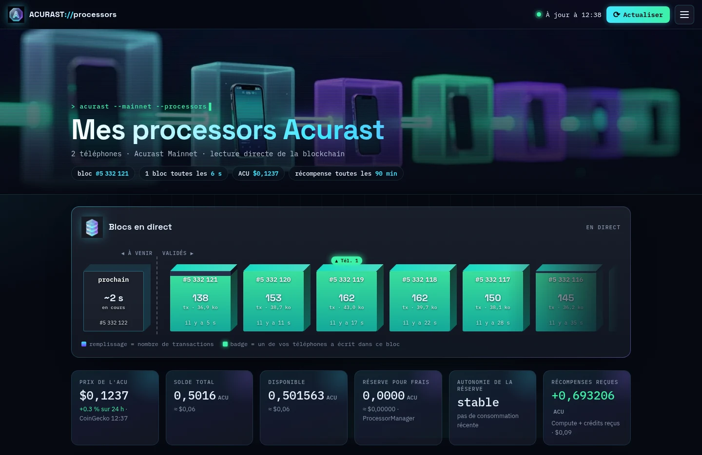
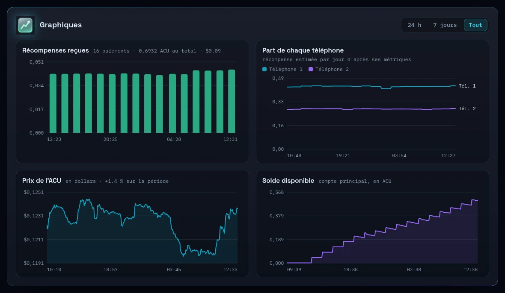
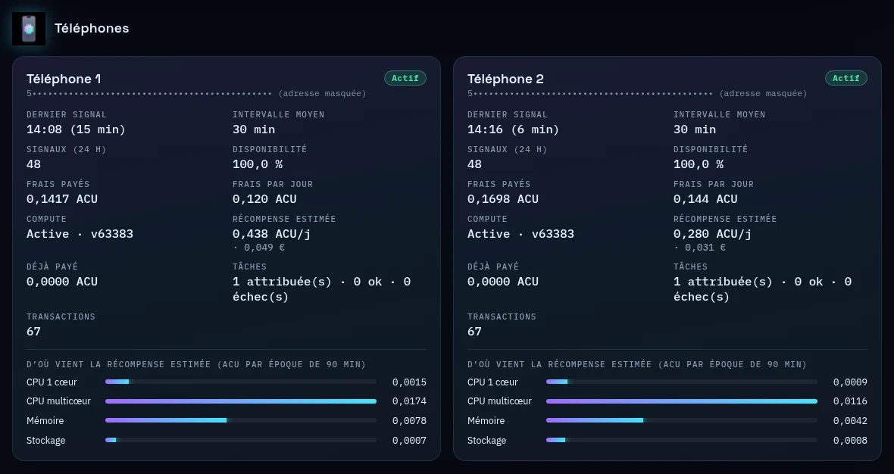
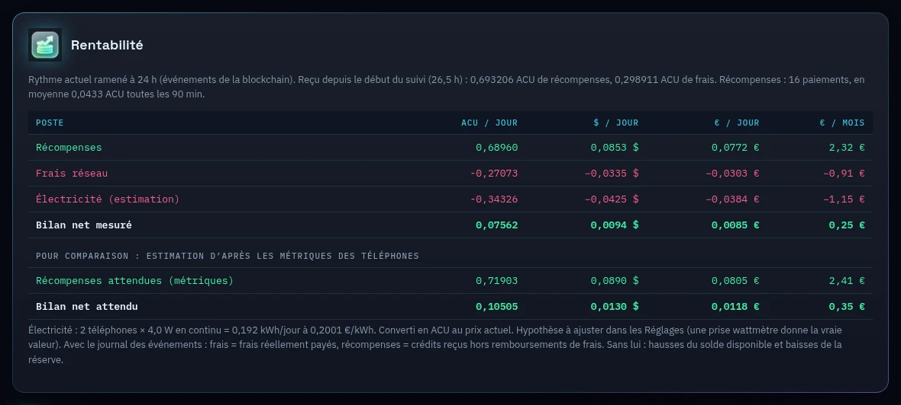
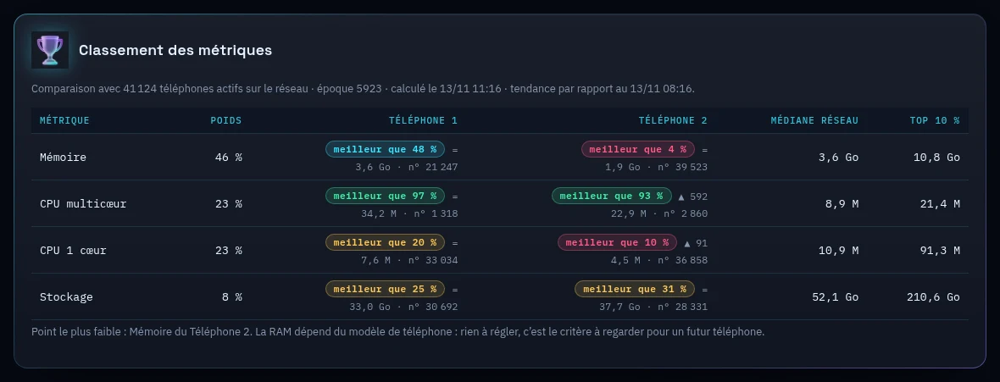
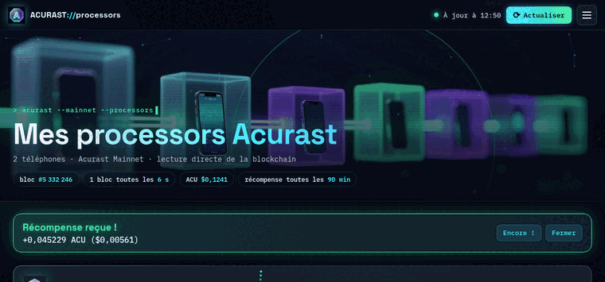

# Tableau de bord pour processors Acurast

> **EN** — A self-hosted, read-only dashboard for people running [Acurast](https://acurast.com) processors on old phones.
> It runs on a Raspberry Pi (or any Linux box), reads the Acurast blockchain directly, and shows rewards, fees,
> real net profit (electricity included), per-phone stats, network ranking, live blocks and alerts through Home Assistant.
> The interface is in French. No private key, no wallet, no account needed: only your public addresses.

Un tableau de bord **auto-hébergé et en lecture seule** pour suivre vos téléphones qui tournent comme processors
Acurast : récompenses, frais, rentabilité réelle (électricité comprise), état de chaque téléphone, classement face au
réseau, blocs en direct et alertes sur votre téléphone via Home Assistant.



## Fonctions

- **Blocs en direct** à la façon de mempool.space : un cube par bloc (toutes les 6 s), rempli selon le nombre de
  transactions, avec un badge quand un de vos téléphones écrit dans le bloc.
- **Synthèse** : prix de l'ACU (CoinGecko), solde, réserve pour frais, récompenses reçues.
- **Rentabilité** : rythme des récompenses, frais réseau réellement payés, électricité estimée, bilan net en ACU, $ et €.
- **Téléphones** : dernier signal, disponibilité, frais, tâches reçues, métriques (CPU, RAM, stockage).
- **Classement des métriques** face à tous les processors du réseau (recalculé toutes les 3 h).
- **Résumé par jour** et **journal des événements** de la blockchain (frais, récompenses, tâches…).
- **Graphiques** avec infobulles : récompenses par paiement, part de chaque téléphone, prix de l'ACU, solde.
- **Réglages depuis la page** : prix du kWh, consommation, ajout / retrait de téléphones, feu d'artifice.
- **Feu d'artifice** à chaque nouvelle récompense (désactivable).
- **Alertes Home Assistant** quand un téléphone n'envoie plus de signal, puis quand il repart.



### Une carte par téléphone

Dernier signal, intervalle moyen, disponibilité, frais payés, statut Compute, récompense estimée et d'où elle vient
(CPU, mémoire, stockage), tâches reçues. Les adresses sont masquées sur la capture.



| Rentabilité | Classement |
|---|---|
|  |  |

### Feu d'artifice à chaque récompense

Toutes les 90 minutes environ, quand une récompense arrive, un bandeau « Récompense reçue ! » s'affiche avec le
montant, accompagné d'un feu d'artifice. Pour le voir sans attendre, ajoutez `#feu-artifice` à la fin de l'adresse de
la page. Il se désactive dans **Réglages → Récompenses**.



## Comment ça marche

Trois petits services Python tournent en arrière-plan (services systemd « utilisateur ») :

| Service | Rôle | Dépendances |
|---|---|---|
| `acurast_releve.py` | Relève les soldes toutes les 5 min, sert la page web (port 8090), gère les réglages et les alertes | bibliothèque standard |
| `acurast_evenements.py` | Lit chaque bloc **finalisé** et garde les événements qui concernent vos comptes | `substrate-interface` |
| `acurast_classement.py` | Lit les métriques de tout le réseau et classe vos téléphones (toutes les 3 h, ~4 min, ~120 Mo) | `substrate-interface` |

Tout passe par le nœud public `https://public-rpc.mainnet.acurast.com`. Les données sont gardées dans `data/`
(CSV et JSON). La page `acurast-dashboard.html` lit ces fichiers et interroge aussi directement la blockchain.

## Installation (Raspberry Pi ou autre Linux)

Il faut Python 3.10 ou plus récent.

```bash
git clone https://github.com/ch4p4t0ub1p/acurast-dashboard.git acurast-dashboard
cd acurast-dashboard
cp config.example.json config.json
nano config.json          # mettez vos adresses (voir ci-dessous)
./installer.sh
```

`installer.sh` vérifie vos adresses, crée l'environnement Python (`.venv`), installe et démarre les trois services.
Pour qu'ils tournent même quand personne n'est connecté au Pi, lancez une fois :

```bash
sudo loginctl enable-linger $USER
```

Ouvrez ensuite `http://<ip-du-pi>:8090/` depuis n'importe quel appareil du réseau local.

Commandes utiles :

```bash
systemctl --user status acurast-releve acurast-evenements acurast-classement
journalctl --user -u acurast-evenements -f
```

## Configuration

`config.json` :

| Clé | Rôle |
|---|---|
| `manager` | adresse du **compte principal** (celui qui reçoit les récompenses, visible dans le hub Acurast) |
| `telephones` | une entrée `{ "nom", "adresse" }` par téléphone : l'**adresse du processor** affichée dans l'app Acurast Processor |
| `electricite` | prix du kWh en € et consommation estimée par téléphone en W (mesurez-la avec une prise wattmètre) |
| `port_http` | port de la page (8090 par défaut) |
| `intervalle_secondes` | intervalle des relevés de solde (300 s) |
| `evenements_depuis_bloc` | facultatif : bloc de départ du journal ; sinon il commence au bloc actuel |
| `feu_artifice`, `alertes` | réglables ensuite depuis la page |

Les adresses Acurast commencent par `5` et font 48 caractères. Seules des **adresses publiques** sont nécessaires :
le tableau de bord ne demande jamais de phrase de récupération ni de clé privée, et n'envoie aucune transaction.

Ensuite, presque tout se règle depuis la page, section **Réglages** : prix du kWh, watts, ajout ou retrait de
téléphones (l'historique est conservé), feu d'artifice, alertes.

## Alertes Home Assistant

1. Dans Home Assistant, créez l'automatisation fournie dans
   [`home-assistant/automatisation-alerte-acurast.yaml`](home-assistant/automatisation-alerte-acurast.yaml)
   (en adaptant l'identifiant du webhook et le nom de votre téléphone).
2. Dans la page : **Réglages → Alertes Home Assistant**, collez l'adresse du webhook
   (`http://<home-assistant>:8123/api/webhook/<identifiant>`), cliquez **Envoyer une alerte de test**.
3. Une fois le test reçu, cochez l'alerte et enregistrez.

Un téléphone envoie normalement un signal toutes les ~30 minutes ; l'alerte part après 75 minutes de silence
(réglable), puis un message « refonctionne » quand il repart. Aucun jeton Home Assistant n'est nécessaire.

## À savoir

- **Le nœud public ne garde l'état que ~25 minutes** : le journal ne peut pas remonter loin dans le passé. Il démarre
  au moment de l'installation.
- **Électricité** : la valeur en W est une estimation tant qu'elle n'est pas mesurée. La recharge par induction
  consomme nettement plus qu'un câble.
- **Estimation d'après les métriques** : calculée à partir de la part de vos téléphones dans chaque pool de
  métriques ; c'est un ordre de grandeur, la ligne « mesuré » fait foi.
- **Sécurité** : la page et ses réglages ne sont accessibles que depuis le réseau local, sans mot de passe.
  N'exposez pas le port 8090 sur Internet.
- **Projet non officiel**, sans lien avec Acurast ou Papers AG. Ce n'est pas un conseil financier.

## Crédits

- Icônes et bandeau générés localement avec [ComfyUI](https://github.com/comfyanonymous/ComfyUI).
- Polices : Space Grotesk, IBM Plex Sans et IBM Plex Mono (Google Fonts).
- Prix : API publique de [CoinGecko](https://www.coingecko.com).

## Soutenir le projet

> sudo rejoindre --cloud-rebellion --code m89va8 ▋

Si ce tableau de bord vous a été utile et que vous rejoignez la Cloud Rebellion d'Acurast,
entrez le code de parrainage **`m89va8`**. C'est gratuit pour vous, et ça me rapporte
15 % en MIST. Une ⭐ sur le dépôt fait aussi très plaisir !

## Licence

[MIT](LICENSE)
